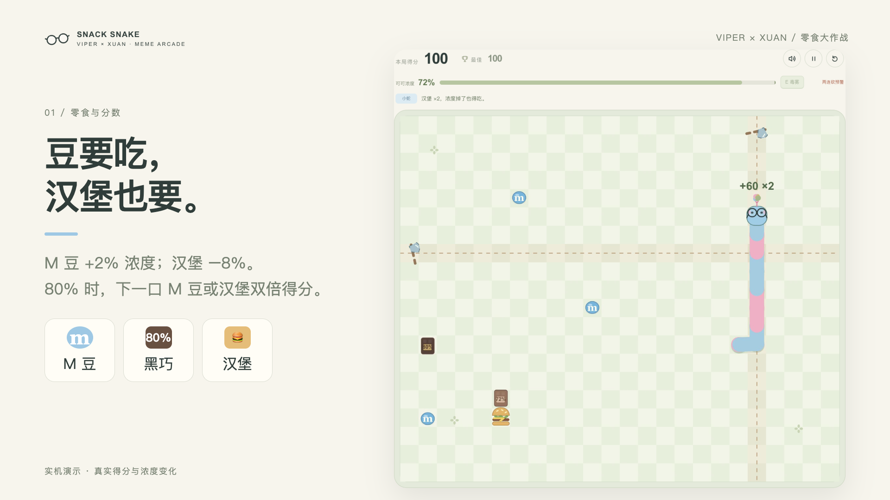

# 粉蓝蛇蛇 · Snack Snake

给粉蓝小蛇戴上圆框眼镜，塞点 M 豆、黑巧和汉堡，再让炫神进来砍两刀。核心还是贪吃蛇，只是零食和干扰都多了一点。电脑、手机都能玩，打开网页就能开吃。

**现在开玩：** [IP 入口（80 端口）](http://8.147.59.78:80/snacksnake/)。域名 [viper3.icu](http://viper3.icu/) 还在等备案，等我搞定了，也能直接从那边进。

**代码已经开源。** 想改点什么、加点新活，欢迎拿去折腾，也欢迎提建议。



## 怎么玩

- 电脑：方向键 / WASD 转向，空格暂停，E 开毒雾。
- 手机：在棋盘上滑一滑，或者点下方方向键；毒雾也有单独按钮。
- M 豆加浓度，80% 黑巧直接拉满；汉堡真香，但会掉 8%。满浓度的下一口 M 豆 / 汉堡双倍得分。
- 炫神会提前画出横竖线，然后“我砍，我再砍”。毒雾能挡斧头，墙和自己还是要躲。
- 经典撞墙、快乐穿墙两种模式。音效和原梗人声默认开，想安静吃也能关。

## 后面可能还会整点新活

先画个饼，**这些还没做进游戏**：

- 再找几个英雄来串门，各带一点不同的干扰。
- 比如卡尔玛过来牵条线：被拴住后得赶紧跑出范围，不然就原地罚站一会儿。
- 有好玩的点子也可以提，先看看小蛇还能遭多少罪。

## 自己跑 / 自己改

直接打开仓库里的 `index.html` 就能玩。也可以启动一个静态服务：

```sh
python3 -m http.server 8765
```

改 `src/` 后运行 `python3 scripts/build.py`，会生成带内嵌原声的单页 `index.html`；不需要前端构建工具。现有逻辑测试：`node --test tests/*.test.cjs`。

代码采用 [MIT](LICENSE)，原声等第三方素材单独列在 [素材说明](NOTICE.md)。
