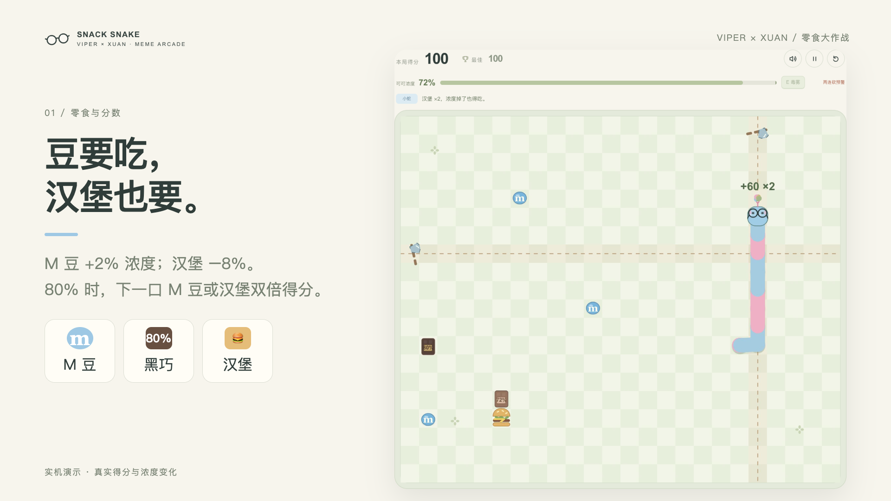

# 我的编程学习笔记 / 粉蓝蛇蛇

这个仓库放的是 [viper3.icu](https://viper3.icu/) 的个人编程学习站，以及其中的 Canvas 小游戏练习。打开域名首页直接进入游戏，`/play/` 保留为同一游戏的入口；项目与开发笔记移至 [/notebook/](https://viper3.icu/notebook/)，游戏左上角可进入，电脑和手机都能玩。

四篇笔记围绕当前项目的实际代码：游戏循环、输入缓冲、伪随机事件与语音队列。站点提供文章目录、搜索和分类；不需要数据库或前端框架。

## 粉蓝蛇蛇 · Snack Snake

给粉蓝小蛇戴上圆框眼镜，塞点 M 豆、黑巧和汉堡，再让炫神进来砍两刀。核心还是贪吃蛇，只是零食和干扰都多了一点。电脑、手机都能玩，打开网页就能开吃。

**现在开玩：** [直接试玩](https://viper3.icu/play/) · [项目介绍](https://viper3.icu/projects/snack-snake/)。原来的 [IP 入口（80 端口）](http://8.147.59.78:80/snacksnake/) 也继续能用。

**代码已经开源。** 想改点什么、加点新活，欢迎拿去折腾，也欢迎提建议。



## 怎么玩

- 电脑：方向键 / WASD 转向，空格暂停，E 开毒雾。
- 手机：在棋盘上滑一滑，或者点下方方向键；毒雾也有单独按钮。
- M 豆加浓度，80% 黑巧直接拉满；汉堡真香，但会掉 8%。满浓度的下一口 M 豆 / 汉堡双倍得分。
- 炫神会提前画出横竖线，然后“我砍，我再砍”。毒雾能挡斧头，墙和自己还是要躲。
- 探照果实会照出小蛇，队友还说“潘森没大”——接着小天真跳进来了。离开金色椭圆就能躲开，毒雾也能挡住；落地命中最多扣 20 分、3 节尾巴和 8% 浓度。
- 卡尔玛会来 W 你：**2 秒内跑出她的圆圈就能挣脱**，否则定身约 1.4 秒。她本人不挡路，毒雾不挡牵线；定身期间斧头照常出，方向可以提前按。出场有冷却，空窗越久越容易来；暂停会冻结计时。
- 经典撞墙、快乐穿墙两种模式。音效和原梗人声默认开，想安静吃也能关。
- 小蛇战袍随时换：**BLG 粉蓝、Griffin 红白、EDG 黑白、HLE 橙灰**。换色不清空本局，刷新也会记住选择。

粉蓝是 BLG 的那件；Griffin 是梦开始的地方，EDG 是 2021 年捧杯的那一站，HLE 也有两段经历。这次把几件战袍都带上了。页面也换成了深灰底、固定细颗粒和淡淡的字符光场，中文仍然用系统黑体。

## 这次更新的新活

卡尔玛牵线、探照果实和小天潘森已加入游戏。三路干扰采用带冷却的伪随机：未触发时逐次提高概率，触发后重新开始冷却，起手之间留一点间隔；牵线与跳大不会同时起手。

后面再找几个英雄来串门。有好玩的点子也可以提，先看看小蛇还能遭多少罪。

新增的卡尔玛，灵感来自 [Viper 开局下路阵亡片段](https://www.bilibili.com/video/BV1QGHA67EMM/)。视频是 BLG 对 MKOI 的开局下路交战；游戏取了卡尔玛 W 的牵线与定身机制。潘森部分参考 [探照果实后被开](https://www.bilibili.com/video/BV1k1xP6EEbE/) 和 [“潘森没大”的采访讨论](https://www.bilibili.com/video/BV1tsxe65ERN/)；R 被打断后返还冷却是相关讨论对报错原因的推测。

## 自己跑 / 自己改

直接打开仓库里的 `play/index.html` 就能玩。浏览完整学习站请在仓库根目录启动静态服务：

```sh
python3 -m http.server 8765
```

打开 `http://127.0.0.1:8765/` 直接玩游戏；学习站地址为 `/notebook/`，原游戏地址 `/play/` 继续可用。

改 `src/` 后运行 `python3 scripts/build.py`，会生成站点全部页面和带内嵌原声的 `play/index.html`。只构建游戏可以加 `--game-only`；构建仅使用 Python 标准库，不需要前端构建工具。现有逻辑测试：`node --test tests/*.test.cjs`。

- `src/site/content.py`：学习笔记正文。
- `src/site/build.py`：首页、项目页、文章和站点地图的生成。
- `src/site/style.css`、`src/site/site.js`：站点样式、字符光场、搜索和分类。
- `src/engine.js`、`src/page.html`、`src/voice.js`：游戏规则、绘制和声音。

生成页面保存在根目录、`notebook/`、`notes/`、`projects/`、`play/` 和 `site-assets/`。部署到域名根目录即可；旧 `/snacksnake/` 入口需要映射到 `play/`。发布清单见 `scripts/package_site.py`，只包含公开页面与资源。

`sw.js` 用于退出域名以前的网盘离线缓存：旧浏览器更新到这个脚本后，会注销旧 Service Worker 并重新加载当前页面，不清除 Cookie、游戏设置或其他域名的数据。新站不注册 Service Worker。部署时须保留这个文件，以 JavaScript 类型和 `Cache-Control: no-store` 返回；直接删除会让部分旧访客继续停在缓存的网盘界面。

代码采用 [MIT](LICENSE)，原声等第三方素材单独列在 [素材说明](NOTICE.md)。
